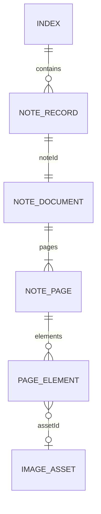

# 技术方案、数据字典与本地接口

更新日期：2026-11-25。现状以 [`src/main`](../src/main/index.ts)、[`storage.ts`](../src/main/storage.ts)、[`src/preload`](../src/preload/index.ts)、[`editor.ts`](../src/shared/editor.ts) 为准。

## 方案与成本

| 层 | 现有选型 | 原因/边界 |
| --- | --- | --- |
| 桌面容器 | Electron 44，electron-vite 6 | 一套 TypeScript 项目打包 Windows/macOS/Linux；真实平台验收仍以 Windows 为先 |
| 界面 | React 19、TypeScript、CSS/Tailwind 4、Radix Dialog、Lucide | 组件和样式已存在；当前画布主要用 SVG |
| 笔迹 | Pointer Events + `perfect-freehand` | 支持压力点与合并事件；大文档性能、设备映射未验收 |
| 本地存储 | 自选资料库目录，默认 Electron `userData/liftink-data` | JSON 索引和文档、内容寻址附件、独立逐文件快照；索引与文档分别原子写入 |
| 测试/打包 | Playwright 驱动 Electron、脚本回归、electron-builder | Windows x64 有本地候选包；签名、覆盖安装与卸载仍需验证 |
| 第三方付费服务 | 无支付、地图、短信、云 AI 或分析服务 | 当前无服务账单；应用分发、签名/公证等实际成本待选渠道后核算 |

安全边界：renderer 无 Node，`contextIsolation` 和 `sandbox` 开启；preload 仅暴露限定 IPC；新窗口打开被拒绝。截图只由用户动作发起。当前 `LIFTINK_TEST_DATA_DIR` 是测试覆盖数据目录的内部开关，不是普通用户配置。

## 数据字典（当前是文件结构，不是 ER 数据库）

| 文件/对象 | 位置与核心字段 | 约束与迁移 |
| --- | --- | --- |
| `index.json` | `userData/liftink-data/index.json`，`{version:1,notes:NoteRecord[]}` | 可读旧数组格式；每次覆盖前写 `.bak`；索引最多 10000 条 |
| `NoteRecord` | `id,title,originalTitle,date,tags,kind,folder,summary,favorite,workspace?,draft?,trashed?` | ID 为 1–96 位字母/数字/`_`/`-`；标签最多 100 个；`draft` 当前未作深层校验 |
| `notes/{id}.json` | `NoteDocument`，含页、富文本、PDF 来源、录音及摘录引用 | `noteId` 与文件 ID 一致；至少 1 页、最多 300 页；写入上限约 4000 万字符 |
| `NotePage` | `id,paper,elements[]`，可含尺寸、纸色、图层和书签 | `paper` 支持 `lines/grid/blank/dots`；旧页可以省略纸色和尺寸 |
| `InkElement` | `kind=ink,id,color,width,points[{x,y,pressure}]` | 颜色 `#RRGGBB`；宽度大于 0、最多 100；点值需有限数 |
| `ImageElement` | `kind=image,id,assetId,x,y,width,height` | 宽高大于 0 且各不超 20000；资源 ID 需符合哈希+扩展名 |
| `assets/{hash}.{ext}` | 图片、PDF 原件、旧版录音字节 | 内容以 SHA-256 校验；原生备份仍支持旧音频。新版已移除录制和转写入口。 |
| `liftink-vault.json` / `vault-settings.json` | 库 ID、文件格式版本、分区、标签、日程、目标、屏蔽词、速记草稿及最近备份时间 | 原应用的资料库级设置在首次打开默认库时从旧配置导入。设备偏好保留在应用配置。短暂待保存记录按库 ID 和路径隔离 |
| Electron `userData/active-vault.json` | 本机当前资料库路径和库 ID | 切换前验证目录；选中的目录不可用时显示恢复入口 |
| `liftink-snapshot.json` | 快照版本、库 ID、文件相对路径、字节数和 SHA-256 | 位于独立快照目录；恢复交给应用逐文件校验，原快照不会被打开为工作库 |

主文件坏且备份有效时先隔离为 `.corrupt-{uuid}` 再恢复；没有有效备份则拒绝覆盖。写入使用临时文件、文件同步和原子替换。此机制不等于索引与文档跨文件事务，也不保证断电绝对安全。

## 本地 IPC 接口（无需独立 HTTP API/Swagger）

renderer 只能通过 `window.liftInk` 调用 preload。加载方法实际返回 `{value,recovered}`；类型声明见 `src/renderer/src/env.d.ts`。

| 方法 | 输入 → 输出 | 主要规则 |
| --- | --- | --- |
| `loadNoteIndex()` / `saveNoteIndex(notes)` | 无 → `StorageLoad<NoteRecord[]>`；记录数组 → `void` | 校验、串行写、备份与恢复 |
| `loadDocument(id)` / `saveDocument(document)` | 笔记 ID → `StorageLoad<NoteDocument>`；文档 → `void` | ID 与结构校验、大小限制 |
| `storeImage(mime,base64)` / `loadImage(id)` | 图片数据 → `StoredImage`；资源 ID → `StoredImage` | MIME、签名、解码、尺寸与哈希校验 |
| `storePdfSource(bytes)` / `readPdfSource(id)` | PDF 字节 → 内容 ID；内容 ID → PDF 字节 | 保留原 PDF；编辑器按页记录来源，导入上限 120 MB |
| `storageInfo()` / `chooseBackupDirectory()` / `writeLibraryBackup(data)` | 查看目录、打开目录选择器或写入备份包 | 写入限于用户选择的备份目录，备份读取及验证见 [`portable.ts`](../src/renderer/src/editor/portable.ts) |
| `vaultOperation(operation)` | 打开、创建、迁移、快照或恢复 → 新目录或取消 | 目录由系统选择器提供。复制与验证在主进程完成，[实现](../src/main/vault.ts) |
| `captureScreen()` | 无 → `CapturedScreen` | 捕获当前指针所在显示器；多屏与权限边界尚需实测 |
| `pinImage(id)` | 图片资源 ID → `void` | 打开置顶独立窗口；复制/保存/贴回尚未实现 |
| `checkReleaseUpdate()` / `downloadRelease(version)` | 无 → 版本号和更新标记或空值；数字版本号 → `void` | 主窗口 Windows x64 请求。主进程匿名读取 GitHub Releases，按版本号选出已发布且含对应安装包的最高版本。下载由默认浏览器处理。 |

## 本地资料库

Obsidian 将资料库放在用户选择的本地文件夹，正文以 Markdown 存放，索引可以重新建立。LiftInk 也可以让用户用文件管理器看到和复制整库，同时用有版本的 JSON 表达手写、图层和 PDF 批注。 [Obsidian 数据存储说明](https://obsidian.md/help/data-storage)

### 第一阶段：整库可选择、可搬迁、可校验（已实现）

- 「设置 → 文件与备份」提供打开、创建及迁移资料库。创建或迁移时选上级目录，应用在其下创建 `LiftInk-资料库` 子目录；应用同时打开一个库。
- 迁移等待待保存内容提交，复制到临时目录并校验文档、附件哈希与引用，验证后切换路径。原资料库保留，出现缺件或写入失败时当前库保持原状。切换后重新加载资料库窗口。
- 快照逐文件写到库外的备份目录，每次留存独立快照。可手动创建，也可在应用停留在首页或设置时定期创建。恢复时选择快照与目标上级目录，应用校验后打开恢复副本。逐文件操作不受 `.liftink` 单包 170 MB 上限约束。 [Obsidian 备份指南](https://obsidian.md/help/backup)
- 资料库存放盘不可用时暂停载入，连接原盘后可点「重试打开」，也可另选已有库或恢复快照。开发验证使用隔离文件夹和合成数据，并保留原资料库。

### 第二阶段：可重建索引和 Markdown 互通（待实现）

- 将当前 `index.json` 独占的标题、标签和目录等信息完整迁入笔记元数据之后，再把全文索引做成可重建缓存。数据量有需要时可用本地 SQLite 做检索，重建缓存之后笔记、标签和关系应保持完整。
- Markdown 笔记可逐步以 `.md` 文件读写，手写及混合笔记保留原生 JSON，附件保留原文件。验收包括外部新增 Markdown、换盘重开、链接稳定、共用附件和回收站引用。

原有 `.liftink` 导出和导入副本继续用于交换和兼容旧备份。

## 环境与构建

- Node/npm：使用与 `package-lock.json` 兼容的 Node 版本；项目尚未固定 `.nvmrc`/`engines`，发布前应固定并在 CI 检查。
- 开发：`npm ci` → `npm run dev`；验证：`npm run build`、`npm run lint` 和关键 Electron 回归脚本。
- `LIFTINK_TEST_DATA_DIR` 只用于隔离自动化数据；真实用户不要设置。版本检查读取公开 GitHub Releases，无需密钥。
- 构建：`npm run build:win` 等；打包产物默认放 `dist/`。应用归档只包含构建产物、运行资源、包清单和生产依赖。本地测试、文档及历史打包产物不进入归档。当前应用 ID 保持兼容。
- Windows 沿用 `%APPDATA%/liftink-desktop` 作为 Electron 配置目录，默认库为下一级 `liftink-data/`。迁移后由本机资料库指针定位用户所选目录。测试目录继续由 `LIFTINK_TEST_DATA_DIR` 隔离。
