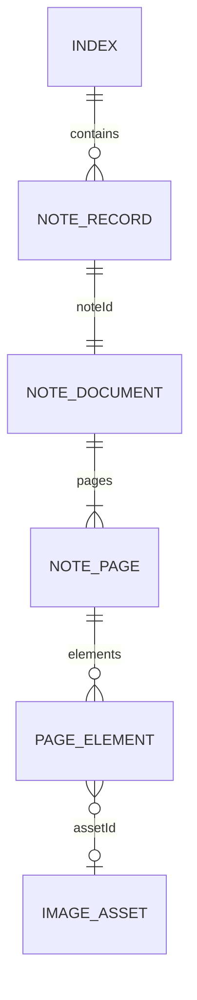

# 技术方案、数据字典与本地接口

更新：2026-11-03。现状以 [`src/main`](../src/main/index.ts)、[`storage.ts`](../src/main/storage.ts)、[`src/preload`](../src/preload/index.ts)、[`editor.ts`](../src/shared/editor.ts) 为准。

## 方案与成本

| 层 | 现有选型 | 原因/边界 |
| --- | --- | --- |
| 桌面容器 | Electron 44，electron-vite 6 | 一套 TypeScript 项目打包 Windows/macOS/Linux；真实平台验收仍以 Windows 为先 |
| 界面 | React 19、TypeScript、CSS/Tailwind 4、Radix Dialog、Lucide | 组件和样式已存在；当前画布主要用 SVG |
| 笔迹 | Pointer Events + `perfect-freehand` | 支持压力点与合并事件；大文档性能、设备映射未验收 |
| 本地存储 | JSON 索引/文档 + 内容寻址图片，Electron `userData/liftink-data` | 无数据库与网络依赖；备份为上一份有效文件；索引/文档尚非跨文件事务 |
| 测试/打包 | Playwright 驱动 Electron、脚本回归、electron-builder | 打包配置仍有模板 `appId`、发布 URL、权限说明占位值，**不得直接发布** |
| 第三方付费服务 | 无支付、地图、短信、云 AI 或分析服务 | 当前无服务账单；应用分发、签名/公证等实际成本待选渠道后核算 |

安全边界：renderer 无 Node，`contextIsolation` 和 `sandbox` 开启；preload 仅暴露限定 IPC；新窗口打开被拒绝。截图只由用户动作发起。当前 `LIFTINK_TEST_DATA_DIR` 是测试覆盖数据目录的内部开关，不是普通用户配置。

## 数据字典（当前是文件结构，不是 ER 数据库）

| 文件/对象 | 位置与核心字段 | 约束与迁移 |
| --- | --- | --- |
| `index.json` | `userData/liftink-data/index.json`，`{version:1,notes:NoteRecord[]}` | 可读旧数组格式；每次覆盖前写 `.bak`；索引最多 10000 条 |
| `NoteRecord` | `id,title,originalTitle,date,tags,kind,folder,summary,favorite,workspace?,draft?,trashed?` | ID 为 1–96 位字母/数字/`_`/`-`；标签最多 100 个；`draft` 当前未作深层校验 |
| `notes/{id}.json` | `{version:1,noteId,pages[]}` | `noteId` 与文件 ID 一致；至少 1 页、最多 200 页；写入上限约 4000 万字符 |
| `NotePage` | `id,paper,elements[]` | `paper` 为 `lines/grid/blank`；每页最多 100000 元素 |
| `InkElement` | `kind=ink,id,color,width,points[{x,y,pressure}]` | 颜色 `#RRGGBB`；宽度大于 0、最多 100；点值需有限数 |
| `ImageElement` | `kind=image,id,assetId,x,y,width,height` | 宽高大于 0 且各不超 20000；资源 ID 需符合哈希+扩展名 |
| `assets/{hash}.{ext}` | 图片字节 | PNG/JPEG/WebP，20 MB 以下、每边 12000 px 以下；目前无引用计数或孤儿清理 |

主文件坏且备份有效时先隔离为 `.corrupt-{uuid}` 再恢复；没有有效备份则拒绝覆盖。写入使用临时文件、文件同步和原子替换。此机制不等于索引与文档跨文件事务，也不保证断电绝对安全。

## 本地 IPC 接口（无需独立 HTTP API/Swagger）

renderer 只能通过 `window.liftInk` 调用 preload。加载方法实际返回 `{value,recovered}`；类型声明见 `src/renderer/src/env.d.ts`。

| 方法 | 输入 → 输出 | 主要规则 |
| --- | --- | --- |
| `chooseImports()` | 无 → `{name,kind}[]` | 用户选择最多 10 个 PDF/图片；仅返回名字与类型，**不保存文件内容** |
| `loadNoteIndex()` / `saveNoteIndex(notes)` | 无 → `StorageLoad<NoteRecord[]>`；记录数组 → `void` | 校验、串行写、备份与恢复 |
| `loadDocument(id)` / `saveDocument(document)` | 笔记 ID → `StorageLoad<NoteDocument>`；文档 → `void` | ID 与结构校验、大小限制 |
| `storeImage(mime,base64)` / `loadImage(id)` | 图片数据 → `StoredImage`；资源 ID → `StoredImage` | MIME、签名、解码、尺寸与哈希校验 |
| `captureScreen()` | 无 → `CapturedScreen` | 捕获当前指针所在显示器；多屏与权限边界尚需实测 |
| `pinImage(id)` | 图片资源 ID → `void` | 打开置顶独立窗口；复制/保存/贴回尚未实现 |

目前没有数据库和前后端 HTTP 分离，所以不建空的表结构迁移文件或 Swagger。引入服务端时先写认证、权限、错误码和版本策略，再加 OpenAPI。

## 环境与构建

- Node/npm：使用与 `package-lock.json` 兼容的 Node 版本；项目尚未固定 `.nvmrc`/`engines`，发布前应固定并在 CI 检查。
- 开发：`npm ci` → `npm run dev`；验证：`npm run build`、`npm run lint` 和关键 Electron 回归脚本。
- `LIFTINK_TEST_DATA_DIR` 只用于隔离自动化数据；真实用户不要设置。没有生产 `.env`、密钥或远端 API 配置。
- 构建：`npm run build:win` 等；打包产物放 `dist/`。配置里的 `com.electron.app`、`https://example.com/auto-updates`、默认麦克风/摄像头权限说明均须在发布前改为真实值并审查。
