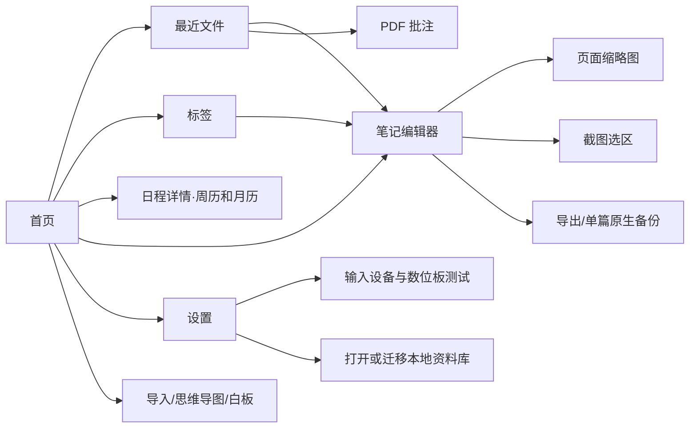

# 页面地图、线框与交互状态

更新日期：2026-11-25。按 [README](../README.md) 执行 `npm run dev` 可体验现有交互。下面的实线是当前可走的路径，虚线表示已讨论的后续功能。



## 低保真线框（结构基线）

```text
首页 / 最近
┌导航：首页 / 文件夹 / 标签┬主区：搜索、新建、最近笔记/列表┬日程侧栏┐
│ 选目录、收藏                 │ 点卡片→编辑；搜索→结果         │ 日程日期 │
└───────────────────────────┴──────────────────────────────┴──────────┘

编辑器
┌返回 / 标题 / 目录 / 标签 / 保存状态──────────────────全屏 / 页面┐
│ 工具：笔 荧光笔 橡皮 选择 手 │ 当前页画布 │ 页面缩略图（可收起） │
│ 颜色 / 图片 / 截图 / 撤销重做  │ 纸张/笔迹/图片│ 新增/切页            │
└纸张类型────────────────────────────────────页码 / 缩放状态────────┘
```

## 当前交互约定

| 入口 | 操作与验收结果 |
| --- | --- |
| 首页日历与日程 | 有日程的日期下方带点。日程卡片顶部加号用于新增，最右侧三个点打开日程详情。周历从左到右为周一至周日七列，每天的日程垂直排列。月历按周分行。点击日期可看单日详情。 |
| 思绪拾光 | 左键查看关联笔记，右键打开「屏蔽关键词」对话框，确认后隐藏该词。取消不改变列表。「设置 → 通用 → 思绪拾光屏蔽词」可恢复显示。 |
| 笔记工具 | 顶栏可编辑多选标签、新建标签和进入全屏。查找、导出、双开用带提示文字的图标。全屏保留画布和书写工具，Esc 或 F11 可退出。 |
| 书写与对象 | 按住钢笔或荧光笔画线，停约 2 秒拉直，抬笔保存。选择工具可移动或调整形状、遮挡胶带、图片和文本框；选中后可删除。文本框按宽度换行，图片和文本框可跨页移动。删除页面需要确认。 |
| PDF | 在笔记中导入时可插在最前、指定页前或最末。原文选择有独立图标，可拖选正文并复制；扫描页可通过 PDF 查找读取 OCR 结果。 |
| 全局搜索 | 首页可直接搜索，其他页面按 Ctrl+K 打开搜索框，按 Esc 返回原位置。 |
| 扫描 PDF | 在 PDF 查找里识别扫描页，使用「复制当前页 OCR 文字」。原文选择适用于 PDF 自带的文字层。 |
| 橡皮 | 保留常用直径。滑块在小尺寸处更细，可直接输入直径，最大为当前页对角线长度。页面大小随纸张变化。 |
| 双开拖图 | 用「选择」工具把左页的截图或普通图片拖到右侧画布。同一笔记的参照页可以接收图片。跨笔记移动先保存右侧，再从左侧移除。 |
| 外观 | 主题色同时应用于首页背景、山景、侧栏和编辑区控件，支持与浅色或深色模式搭配。纸张和笔迹使用各自的设置。 |
| 设置 | 应用内提供通用、外观、书写体验、输入设备、画布与笔记、文件与备份、快捷键、关于与诊断八类。内容区可滚轮滚动或拖动滚动条。详细数位笔测试从「输入设备」进入。 |
| 本地资料库 | 「设置 → 文件与备份」可打开现有库，创建空库或迁移当前库。迁移保留原库。可在库外创建带校验的独立快照，也可恢复到新文件夹并打开。资料盘不可用时提供重试与恢复入口。 |

笔记内容始终是主区，保存状态在常规编辑顶栏可见。保存失败应有可持续查看的提示。

## 交互与异常文案

| 场景 | 触发与处理 | 用户提示（目标文案） | 状态 |
| --- | --- | --- | --- |
| 空目录 | 当前目录没有真实笔记 | “这里还没有笔记。新建一篇开始书写。” | 待完善 |
| 搜索无结果 | 元数据无匹配 | “没有找到匹配的笔记。” | 已有近似文案 |
| 首次载入中 | 索引尚未读完，点击新建 | “笔记目录仍在加载，暂时无法新建。” | 已有 |
| 索引读取失败 | 主文件和备份均不可用 | “读取本地笔记目录失败，已阻止覆盖原文件。” | 已有 |
| 文档从备份恢复 | 主文件损坏但备份有效 | “笔记已从备份恢复，请核对最近的修改。” | 已有近似文案 |
| 保存失败 | 文档或索引写入失败 | “保存失败。修改仍在当前窗口中，请检查磁盘并重试。” + `重试保存` | 部分已有 |
| 关闭时仍未保存 | 队列失败或仍未完成 | “有笔记或目录未能保存。继续编辑可重试；仍要退出可能丢失本次修改。” | 已有；需实测 |
| 图片缺失 | 文档引用不存在的资源 | “有图片未找到，已显示占位。请核对备份。” | 部分已有 |
| 图片超限/格式错误 | 导入被拒 | “无法添加图片。仅支持 PNG、JPEG、WebP，单文件不超过 20 MB。” | 需统一文案 |
| 截图权限不足 | 系统拒绝屏幕捕获 | “无法截图。请在系统设置中允许 LiftInk 录制屏幕，然后重试。” | macOS 待测 |
| 截图取消 | 用户关闭选区 | 无提示；不创建图片、不记撤销 | 已有初版 |
| 输入越界 | 标题空白、页数/文档大小超限 | 空标题归为“未命名笔记”；容量上限给可操作提示 | 部分已有 |
| 并发冲突 | 将来同笔记多窗口写入 | “这篇笔记已在另一窗口打开。请关闭其中一个窗口后重试。” | 未做；MVP 前禁止双写 |
| 断网 | 目前本地写作不依赖网络 | 不弹错误；将来联网功能单独设计离线态 | 当前适用 |

## 视觉规范与状态稿索引

现行色值、字号、行高和圆角直接以 [`tokens.css`](../src/renderer/src/assets/tokens.css) 与 [`typography.css`](../src/renderer/src/assets/typography.css) 为准：强调色 `#6856d4`、正文 `#282b3e`、正文 14px、页面标题 22px、面板圆角 18px。不要另建一套漂移的设计 token。

| 组件 | 正常 | 悬停 | 选中 | 禁用 | 空态 | 报错 |
| --- | --- | --- | --- | --- | --- | --- |
| 笔记卡/列表 | [现有截图](../screenshots/home-1440x900.png) | 代码已实现菜单露出 | 收藏/目录选择已实现 | 不适用 | 待补 | 索引错误待补视觉稿 |
| 编辑工具/画布 | [现有截图](../screenshots/live-editor-1440x900.png) | 指针/工具悬停已实现 | 工具、图片选择已实现 | 撤销/重做已实现 | 空白页已实现 | 保存失败提示已有；视觉验收待补 |
| 页面栏 | [现有截图](../screenshots/new-note-pages-open-1440x900.png) | 待截图 | 当前页已实现 | 删除末页规则待做 | 一页状态已实现 | 损坏文档状态待补 |

现有截图是**实现快照**，不是六状态高保真设计稿。正式高保真仍缺空态、报错态和目标缩放/导出状态；进入对应功能施工前补齐。组件库和内置 SVG 足够当前使用，不单独制作切图包。
